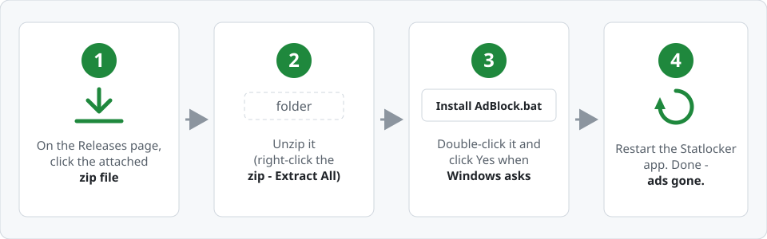
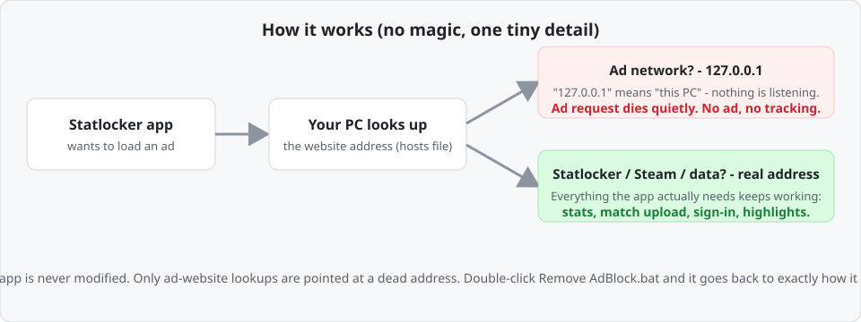

# Statlocker Ad Block

**Removes the third-party ads from the Statlocker Deadlock companion app. One double-click. No install. No account. Fully reversible.**

You play Deadlock. You love checking your stats. You do not want the companion app turning into a billboard. This tool blocks the ad networks the app talks to — the ads disappear, and everything else (your stats, match uploads, sign-in, highlights) keeps working exactly as before.

---

## Install (30 seconds, no technical knowledge needed)

There is no program to install and no "download" button on the app — you download the **folder** from this page:

1. **Get the files.** On this page, click the green **Code** button (top right) → **Download ZIP**.
2. **Unzip.** Right-click the downloaded `statlocker-adblock-main.zip` → **Extract All** → pick a folder (Desktop is fine).
3. **Install.** Open that folder and double-click **`Install AdBlock.bat`**. A Windows window pops up asking for permission — **click Yes**. You'll see "Done!".
4. **Restart the app.** Quit Statlocker completely (right-click its tray icon → Quit), then start it again.

That's it. Ads gone.

> **Windows permission pop-up ("Do you want to allow this app to make changes?")** is completely normal — it's Windows asking, for your protection, because the change touches a system file. Clicking **Yes** is all this tool ever asks of you.

## Undo (also 30 seconds)

Double-click **`Remove AdBlock.bat`** in the same folder, click Yes. Your system goes back to exactly how it was. Nothing is left behind.

## "Do the ads come back after a while?"

No — but the *list* of ad domains is maintained here on GitHub:

- When you install, the tool **fetches the newest list from this repo** (if you're online), so you always get the current blocklist.
- An automated **domain watcher** runs every 12 hours, watches Statlocker's ad pages, and adds any new ad partner to the list automatically.
- If you ever want to be sure, double-click **`Check AdBlock Status.bat`** — it tells you how many domains are blocked and when the block was last installed.

If you installed a while ago and ads suddenly appear, just double-click **`Install AdBlock.bat`** again — it updates the list to the latest version.

## Is this safe?

| Question | Answer |
|---|---|
| Does it modify the Statlocker app? | **No.** The app's files are never touched. |
| Does it install anything? | **No.** No program, no service, no background process. One marked section in Windows' hosts file. |
| Does it send my data anywhere? | **No.** It runs entirely offline on your PC. The only thing it touches online is this repo's domain list. |
| Does it affect my game or my stats? | **No.** The app still signs in, uploads matches, and shows all stats. Only the *ad* requests die. |
| Can it break my PC's internet? | **No.** Only the specific ad domains in the list are blocked — everything else resolves normally. |
| Is it reversible? | **Completely.** Double-click `Remove AdBlock.bat`. A backup of your original hosts file is also kept next to it. |
| Will I get banned in Deadlock? | This is not a game cheat — it's a personal DNS filter, the same kind of thing ad blockers do for your browser. The app itself works normally and reports normally. |

## FAQ

**Why do I need to click "Yes" on a Windows pop-up?**
Editing the hosts file is a system-level change, so Windows asks. That's Windows being careful, not this tool being dangerous.

**I clicked "No" on the pop-up and now it says something went wrong.**
Nothing was changed. Double-click the file again and click Yes.

**It says "Could not reach GitHub to check for list updates".**
You're probably offline — the tool just uses the list bundled with the folder instead, which still works. Re-run the install when you're back online to pick up any updates.

**Ads still showing after install.**
Make sure the app was *fully quit* (tray icon → Quit), not just window-closed. If it's still there, run `Check AdBlock Status.bat` and [open an issue](https://github.com/XGradien/statlocker-adblock/issues/new) with its output — the template walks you through it.

**Does this also remove ads from the statlocker.gg website in my browser?**
It blocks the same ad domains at your PC level, so yes — the website's ads will also be gone. Browser extensions like uBlock Origin do the same thing per-browser.

**I'm on Mac / Linux.**
This is Windows-only for now. The same idea (a `/etc/hosts` entry) is possible on other systems — contributions welcome.

## What this is (and isn't)

This is a **personal-use tool**: a maintained list of the third-party ad domains the Statlocker companion app uses, plus a small script that applies/removes it in your Windows hosts file. It contains no part of Statlocker, uses no private access, and breaks no rules of your PC — it's the same mechanism every ad blocker uses, applied to a desktop app instead of a browser.

**A fair note:** Statlocker is a free product that is ad-funded. If you value their work, the simplest support is to not use this tool — or to enjoy their app with the ads. This repo exists because many Deadlock players found the companion app's ad load intrusive and wanted a clean, safe, reversible way to turn it off.

## Disclaimer

Not affiliated with Statlocker or Valve Corporation. "Statlocker" and "Deadlock" are the property of their respective owners; they are mentioned only to identify what this tool affects. Use at your own discretion.

## Technical notes (for the curious)

- **Mechanism:** marked section in `C:\Windows\System32\drivers\etc\hosts` mapping each ad domain to `127.0.0.1`. Apex domains cover all subdomains via Windows DNS parent-chain lookup.
- **Safety contract:** every write is idempotent, verified by read-back, and backed up to `hosts.bak-statlocker-adblock` first. A whitelist (app, Steam/Valve, video playback, CDN, cert/OCSP endpoints) guarantees the app's own traffic is never touched.
- **Maintenance:** the [domain watcher](https://github.com/XGradien/statlocker-adblock/actions/workflows/refresh-domains.yml) (GitHub Actions, every 12h) fetches Statlocker's public ad-surface pages and their Playwire/RAMP config, diffs them against `domains.txt`, and opens a PR with anything new. See [CONTRIBUTING](CONTRIBUTING.md).
- **Known limitation:** if Statlocker ever starts serving ad creatives from their *own* domains, hosts blocking can't follow (it would break the app). The watcher will surface that; the fix would be a script/element filter à la uBlock.

## Files

| File | What it is |
|---|---|
| `Install AdBlock.bat` | Double-click to install (also updates the list to latest) |
| `Remove AdBlock.bat` | Double-click to undo |
| `Check AdBlock Status.bat` | Double-click to see what's active |
| `adblock.ps1` | The engine behind the .bat files |
| `domains.txt` | The blocklist (auto-maintained by the watcher) |
| `tools/` | The domain watcher scripts (run in CI) |

Released under the [MIT License](LICENSE).
